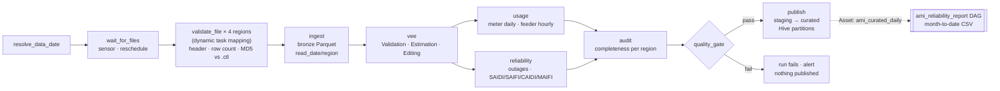

# Smart-Meter (AMI) Data Pipeline: Apache Airflow + PySpark + Hive

[](https://github.com/sumaksharikaa/smart-meter-airflow-pipeline/actions/workflows/ci.yml)


This is a production-style daily pipeline for **utility smart-meter (AMI) data**, orchestrated by **Apache Airflow 3**
and processed with **PySpark**, with results published as partitioned **Hive** tables. It turns raw 15-minute interval
reads from regional head-end systems into billing-grade usage data, feeder load profiles and the reliability indices
utilities report to regulators (**SAIDI, SAIFI, CAIDI, MAIFI**).

> **Note:** this is a personal portfolio project. All data is synthetic, produced by the included generator. No client code or data is used.

---

## The DAG



**Write-audit-publish.** Every table for the day is written to a staging zone first, audited, and only promoted to
the curated zone and registered in Hive if the quality gate passes. Downstream consumers (Hive queries, the
data-triggered report DAG) never see a bad day.

## What it demonstrates

**Airflow 3**
- TaskFlow API (`airflow.sdk`), a **sensor in reschedule mode** that doesn't hold a worker slot while waiting for files,
  and **dynamic task mapping** with one validation task per region (`.partial().expand()`).
- **Data-aware scheduling.** `publish` updates an **Asset**, which triggers the reporting DAG. Nothing is time-coupled.
- **Retries with exponential backoff** for transient failures, while bad data **fails fast**
  (`AirflowFailException`, no retries): retrying can't fix a truncated file.
- **Failure callbacks** that write an alert record and post to a Slack/Teams webhook when configured.
- **Reprocessing.** Trigger with `{"data_date": "YYYY-MM-DD"}`. Every step is idempotent per day.
- `max_active_runs=1`, execution timeouts, a `Param`-validated config, and DAG docs rendered in the UI.

**Utility domain (Spark)**
- **File-level controls.** Each region's file arrives with a control file declaring its row count and MD5. A truncated
  or corrupted transfer is quarantined with a reason before it can reach the warehouse.
- **VEE (Validation, Estimation, Editing)**, the standard utility process for meter data, built entirely from Spark window functions:
  - an expected grid of every active meter × 96 intervals, so missing reads are visible rather than silently absent;
  - impossible spikes (above the physical maximum for the service type) and negative reads are **EDITED**;
  - gaps of up to 2 hours are **ESTIMATED** by linear interpolation; longer gaps stay **MISSING** instead of being invented;
  - zero usage during an outage stays a valid **ACTUAL**.
- **Reliability indices (IEEE 1366).** Power-off/power-on events are paired into outages (outages still unrestored at
  midnight are marked ONGOING), and momentary interruptions under 5 minutes count toward MAIFI only.
- **Feeder hourly load profiles** with each feeder's peak hour, and **meter daily usage** flagged billing-ready.
- **Hive.** Hive-style `read_date=/region=` partitions are registered in a Hive metastore (`ALTER TABLE … RECOVER PARTITIONS`).

## End-to-end proof

`make e2e` (also run in CI) executes the **real DAGs** with Airflow's `dag.test()` through a realistic operations
story, and asserts every outcome:

| Step | What happens | Result |
|---|---|---|
| 2026-11-02 | Normal day: 189,669 reads, 380 duplicates removed, 4 rows from an unknown meter | ✅ published |
| 2026-11-03 | NORTH_COAST file **truncated in transfer** (44,350 of 44,850 rows). Validation rejects it (`row count 44350 != control file 44850`), completeness drops to 0% | ❌ **quality gate fails**, publish skipped, alert written |
| 2026-11-03 | Head-end **re-sends** the complete file; the day is re-run | ✅ published (NORTH_COAST 99.29% complete) |
| 2026-11-04 | Normal day | ✅ published |
| Report DAG | Triggered by the Asset; month-to-date SAIDI/SAIFI/CAIDI/MAIFI by region | ✅ CSV for 3 days |

Typical day after VEE: **190,272 expected intervals**, of which 99.4% are actual, plus about 120 edited, about 170
estimated and 0.4% left missing (mostly meters that didn't report at all).

## Quickstart

**Run everything locally (no Docker):** Python 3.10–3.13 and Java 17.
```bash
git clone https://github.com/sumaksharikaa/smart-meter-airflow-pipeline.git
cd smart-meter-airflow-pipeline
python -m venv .venv && source .venv/bin/activate
make install   # Airflow pinned with its official constraints file + this package
make test      # unit + DAG integrity tests
make e2e       # the full scenario above, on the real DAGs
```

**Airflow UI with Docker:**
```bash
make data      # synthetic files into ./data (day 2 has the truncated file)
make up        # http://localhost:8080 (admin password is printed in the logs)
```
Trigger `ami_daily_pipeline` with `{"data_date": "2026-11-02"}`, then `2026-11-03` to watch the gate stop a bad day.
Re-send the corrected file with
`python data_generator/generate_ami_data.py --root data --resend NORTH_COAST:2026-11-03` and clear the run.

**One job outside Airflow** (spark-submit style, e.g. for EMR or Dataproc):
```bash
python -m meter_pipeline.jobs vee --ds 2026-11-02
```

## Project structure

```
├── dags/
│   ├── ami_daily_pipeline.py      # sensor → mapped validation → Spark jobs → gate → publish (Asset)
│   └── ami_reliability_report.py  # Asset-triggered month-to-date reliability report
├── src/meter_pipeline/
│   ├── files.py                   # control-file validation and quarantine
│   ├── ingest.py                  # landing → bronze Parquet (idempotent partition overwrite)
│   ├── vee.py                     # validation, estimation, editing (window functions)
│   ├── metrics.py                 # daily usage, feeder load, outages, IEEE 1366 indices
│   ├── quality.py                 # audit + gate decision
│   ├── publish.py                 # staging → curated, Hive registration
│   ├── jobs.py                    # one entry point per task (+ CLI)
│   └── alerts.py                  # failure callback: alert file + webhook
├── data_generator/                # AMI head-end simulator (gaps, spikes, outages, truncation, re-send)
├── scripts/run_e2e.py             # end-to-end DAG scenario with assertions
├── docker/Dockerfile              # Airflow 3 + Java + PySpark
├── docker-compose.yaml
└── tests/                         # VEE, reliability math, file checks, gate, DAG integrity
```

## Design notes

- **Why an expected grid?** Joining reads to "every meter × every interval" is what makes missing data measurable.
  Completeness, and the gate built on it, can't exist otherwise.
- **Why fail instead of publishing partial data?** Billing and regulatory numbers built on a quarter of a region's
  meters are worse than late numbers. The gate threshold (98% per region) and the rejected-file policy live in
  [`conf/pipeline.yaml`](conf/pipeline.yaml).
- **Spark placement.** Tasks run Spark in local mode inside the worker, which keeps the project runnable anywhere. On a
  cluster, the same `jobs.py` entry points go behind `SparkSubmitOperator`, EMR or Dataproc operators without code changes.

## License

MIT
